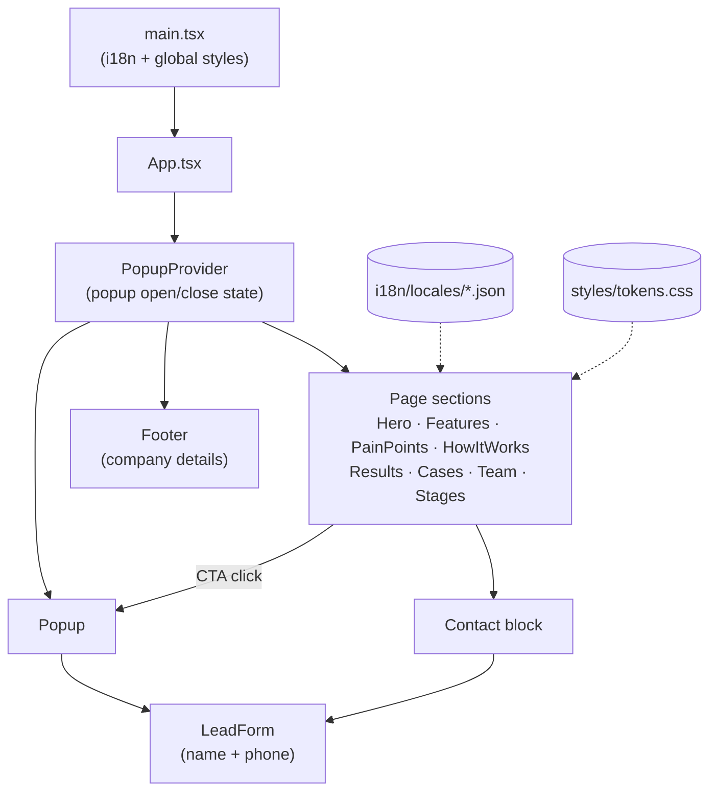

<div align="center">

# 🤖 Nychvision

**AI salespeople that answer, qualify and sell — 24/7.**

The marketing landing page for Nychvision's AI sales assistants: a single-page React app with animated sections, a lead-capture form, and full multi-language support.


</div>

---

## 📖 Overview

Nychvision (NYCHVISION OÜ, Tallinn) builds AI sales assistants that talk to leads, qualify them, book meetings and keep the CRM up to date. This repository is the public landing page that sells that service:

1. A visitor sees the **value proposition**, the **pain points** of a human-only sales team, and **how the AI agent works** in chat and in the CRM.
2. **Results, case studies, the team and the implementation stages** build trust.
3. Every call-to-action opens a **lead form** (name + international phone number) so the visitor can request a demo or consultation.

The layout is a 1:1 rebuild of the original Tilda landing page, reimplemented in React with plain CSS, a centralized color palette, and i18n.

## ✨ Features

|                                  |                                                                                                                                                                                            |
| -------------------------------- | ------------------------------------------------------------------------------------------------------------------------------------------------------------------------------------------ |
| 🌍 **Multi-language**            | react-i18next with English as the default; the language is only switched by an explicit choice (`?lng=` or the in-page switcher) and remembered in `localStorage`                          |
| 🎨 **One-file theming**          | Every color lives as a CSS custom property in [`src/styles/tokens.css`](src/styles/tokens.css) — change the palette without touching components                                            |
| 📱 **Responsive**                | Pixel-matched desktop layout, with dedicated breakpoints for small laptops (≤1199px), tablets (≤959px) and phones (≤639px)                                                                 |
| ☎️ **International phone input** | `react-phone-number-input` with country flags, localized country names and validation (defaults to Estonia, +372)                                                                          |
| ✨ **Animated effects**          | Particle "constellation" canvas, glowing orbs, animated dashed connector lines, cursor-following spotlights, 3D tilt icons and a 3D photo slider — all respecting `prefers-reduced-motion` |
| 🖼️ **Image placeholders**        | Every image slot is a labeled placeholder showing what goes there and its source size, ready to be swapped for real assets                                                                 |

## 🏗️ Architecture



It is a static, client-only app — there is no backend yet. See [Lead form](#-lead-form) for the integration point.

## 📁 Project structure

```
ai-team-nych-vision/
├── index.html              HTML shell, Google Fonts (Manrope)
├── src/
│   ├── main.tsx            Entry point — loads i18n and global styles
│   ├── App.tsx             Page composition (section order)
│   ├── sections/           One folder-level component + CSS file per page section
│   ├── components/         Shared UI: Button, LeadForm, Popup, LanguageSwitcher,
│   │                       ImagePlaceholder, RichText, AnimatedLine
│   ├── effects/            Visual effects: TechCanvas, WaveOrb, GlowScene,
│   │                       CircuitLines, Tilt, spotlight helper
│   ├── i18n/
│   │   ├── index.ts        i18next setup and supported languages
│   │   └── locales/        en.json · ua.json · ru.json · et.json
│   └── styles/
│       ├── tokens.css      Design tokens — the whole color palette
│       └── global.css      Reset, container, shared type scale, timeline
├── vite.config.ts
└── tsconfig.json
```

## 🧰 Tech stack

| Layer              | Technology                                                 |
| ------------------ | ---------------------------------------------------------- |
| UI                 | React 19 · TypeScript                                      |
| Build & dev server | Vite                                                       |
| Styling            | Plain CSS (one file per component) · CSS custom properties |
| Translations       | i18next · react-i18next · i18next-browser-languagedetector |
| Forms              | react-phone-number-input (libphonenumber metadata)         |
| Font               | Manrope (Google Fonts)                                     |

## 🚀 Getting started

### Prerequisites

- Node.js **≥ 20**

### 1. Install dependencies

```bash
git clone <repo-url>
cd ai-team-nych-vision
npm install
```

### 2. Run locally

```bash
npm run dev
```

Opens the site at http://localhost:5173 _(Vite picks the next free port if 5173 is taken)_. Add `?lng=ua` to the URL to open it in another language.

### 3. Build for production

```bash
npm run build
```

Type-checks the project, then outputs a static site to `dist/` that can be hosted on any static host (Netlify, Vercel, S3, nginx…). Preview the build with `npm run preview`.

## 🧭 Page sections

```
Hero  →  Features  →  Pain points  →  How it works  →  Results  →  Case studies  →  Team & clients  →  Stages & contact  →  Footer
```

Each section is a component in [`src/sections/`](src/sections/); the order is set in [`App.tsx`](src/App.tsx). `FinalCta` is implemented but currently disabled there.

## 🌍 Translations

| Language  | File      | Status                     |
| --------- | --------- | -------------------------- |
| English   | `en.json` | ✅ Default                 |
| Ukrainian | `ua.json` | ⏸️ Translated, not enabled |
| Russian   | `ru.json` | ⏸️ Translated, not enabled |
| Estonian  | `et.json` | ⏸️ Translated, not enabled |

**Adding or enabling a language:**

1. Create `src/i18n/locales/<code>.json` with the same keys as `en.json`.
2. In [`src/i18n/index.ts`](src/i18n/index.ts), import it, add it to `resources`, and add the code to `SUPPORTED_LANGUAGES` — the switcher picks it up automatically.

Translation strings can contain inline tags, rendered by the `RichText` component:

| Tag                  | Renders as               |
| -------------------- | ------------------------ |
| `<accent>…</accent>` | Text in the accent color |
| `<b>…</b>`           | Bold                     |
| `<m>…</m>`           | Medium weight (500)      |
| `<br/>`              | Line break               |

Legal company details in the footer are intentionally **not** translated.

## 🎨 Theming

All colors are CSS custom properties in [`src/styles/tokens.css`](src/styles/tokens.css):

| Token group                                                      | Used for                                                                 |
| ---------------------------------------------------------------- | ------------------------------------------------------------------------ |
| `--color-bg*`, `--color-surface*`, `--color-panel*`              | Page, card and panel backgrounds                                         |
| `--color-accent` (+ `-rgb`, `-strong`, `-hot`, `-soft`, `-deep`) | Primary brand color and its shades — buttons, headings, glows, gradients |
| `--color-accent-2`                                               | Secondary accent (final CTA)                                             |
| `--color-light-*`                                                | The light results/case-studies panel                                     |
| `--color-input-*`, `--color-error`                               | Form fields and validation                                               |
| `--gradient-pain`                                                | "Weak spots" section background                                          |

> When changing `--color-accent`, update `--color-accent-rgb` to the same color — it is used for semi-transparent glows.

## 🖼️ Replacing placeholders

Images are rendered with `<ImagePlaceholder label="…" width={…} height={…} />`. The label and size tell you which asset goes where. To add a real image, put it in `public/` (or import it) and replace the placeholder with an `` of the same size.

## 📨 Lead form

[`LeadForm.tsx`](src/components/LeadForm.tsx) validates the phone number and shows a thank-you message, but **does not send data anywhere yet**. Wire it to your CRM or API at the `TODO` in `onSubmit` — the phone value is already in E.164 format (e.g. `+37255512345`).

## 📜 Scripts

| Command           | What it does                               |
| ----------------- | ------------------------------------------ |
| `npm run dev`     | Start the Vite dev server with hot reload  |
| `npm run build`   | Type-check (`tsc -b`) and build to `dist/` |
| `npm run preview` | Serve the production build locally         |

---

<div align="center">

**NYCHVISION OÜ** · Registry code 17602105 · Tallinn, Estonia · [Nychvision@gmail.com](mailto:Nychvision@gmail.com)

</div>
