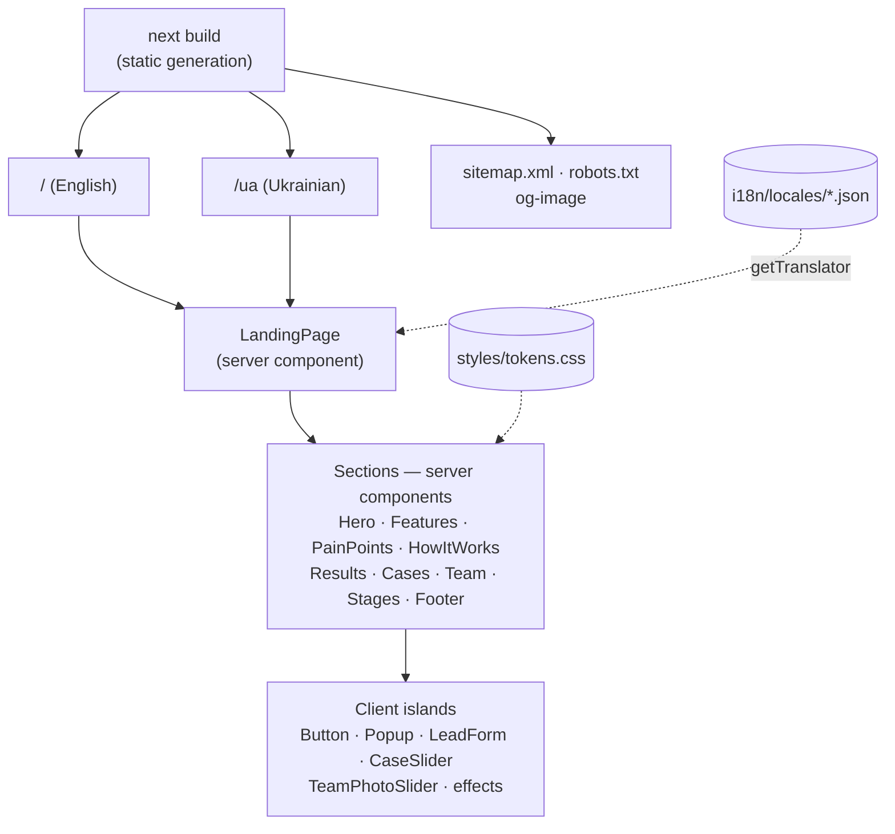

<div align="center">

# 🤖 Nychvision

**AI salespeople that answer, qualify and sell — 24/7.**

The marketing landing page for Nychvision's AI sales assistants: a statically generated Next.js site with animated sections, a lead-capture form, multi-language pages, and SEO built in.


</div>

---

## 📖 Overview

Nychvision (NYCHVISION OÜ, Tallinn) builds AI sales assistants that talk to leads, qualify them, book meetings and keep the CRM up to date. This repository is the public landing page that sells that service:

1. A visitor sees the **value proposition**, the **pain points** of a human-only sales team, and **how the AI agent works** in chat and in the CRM.
2. **Results, case studies, the team and the implementation stages** build trust.
3. Every call-to-action opens a **lead form** (name + international phone number) so the visitor can request a demo or consultation.

The layout is a 1:1 rebuild of the original Tilda landing page, reimplemented in Next.js with plain CSS, a centralized color palette, and i18n.

## ✨ Features

|                                  |                                                                                                                                                                                              |
| -------------------------------- | -------------------------------------------------------------------------------------------------------------------------------------------------------------------------------------------- |
| 🔎 **SEO-ready**                 | Every language is pre-rendered to static HTML with its own `<html lang>`, canonical URL, hreflang alternates, Open Graph/Twitter tags, generated share image, JSON-LD, sitemap and robots.txt |
| 🌍 **Multi-language**            | One URL per language (`/`, `/ua`, …) rendered on the server from JSON translation files — no client-side language switching                                                                  |
| 🎨 **One-file theming**          | Every color lives as a CSS custom property in [`src/styles/tokens.css`](src/styles/tokens.css) — change the palette without touching components                                              |
| 📱 **Responsive**                | Pixel-matched desktop layout, with dedicated breakpoints for small laptops (≤1199px), tablets (≤959px) and phones (≤639px)                                                                   |
| ☎️ **International phone input** | `react-phone-number-input` with country flags, localized country names and validation (defaults to Estonia, +372), loaded lazily in its own chunk                                            |
| ✨ **Animated effects**          | Particle "constellation" canvas, glowing orbs, animated dashed connector lines, cursor-following spotlights, 3D tilt icons and a 3D photo slider — all respecting `prefers-reduced-motion`   |
| 🖼️ **Image placeholders**        | Every image slot is a labeled placeholder showing what goes there and its source size, ready to be swapped for real assets                                                                   |

## 🏗️ Architecture



- **Server components** render all text, so the full content is in the HTML that search engines receive.
- **Client components** (`'use client'`) are only the interactive parts: CTA buttons and the popup, the lead form, the two sliders, and the visual effects. They get their text as props from the server.
- Each language has its **own root layout** (`app/(default)` for English, `app/(localized)/[locale]` for the others) so `<html lang>` is correct on every page.

It is a static site with no backend yet. See [Lead form](#-lead-form) for the integration point.

## 📁 Project structure

```
ai-team-nych-vision/
├── next.config.ts
├── .env.example                   NEXT_PUBLIC_SITE_URL
└── src/
    ├── app/
    │   ├── (default)/             "/" — English root layout + page
    │   ├── (localized)/[locale]/  "/ua", … — root layout + page per extra language
    │   ├── og-image/route.tsx     Generated 1200×630 share image (/og-image)
    │   ├── global-not-found.tsx   Site-wide 404
    │   ├── sitemap.ts             sitemap.xml with hreflang alternates
    │   └── robots.ts              robots.txt
    ├── components/                LandingPage, RootDocument (html/body + font), StructuredData (JSON-LD),
    │                              Button, Popup, LeadForm, LanguageSwitcher, ImagePlaceholder, AnimatedLine
    ├── sections/                  One component + CSS file per page section
    │                              (CaseSlider and TeamPhotoSlider are their client-side parts)
    ├── effects/                   TechCanvas, WaveOrb, GlowScene, CircuitLines, Tilt, SpotlightTracker
    ├── i18n/
    │   ├── config.ts              Published languages, default language, language tags
    │   ├── translator.ts          getTranslator(locale) → t / rich / raw
    │   ├── rich.ts                Renders <accent>, <b>, <m>, <br/> in translations
    │   └── locales/               en.json · ua.json · ru.json · et.json
    ├── lib/                       seo.ts (metadata), company.ts (legal details), leadForm.ts
    └── styles/
        ├── tokens.css             Design tokens — the whole color palette
        └── global.css             Reset, container, shared type scale, timeline
```

## 🧰 Tech stack

| Layer        | Technology                                                  |
| ------------ | ----------------------------------------------------------- |
| Framework    | Next.js 16 (App Router, static generation) · React 19       |
| Language     | TypeScript 7                                                |
| Styling      | Plain CSS (one file per component) · CSS custom properties  |
| Translations | JSON dictionaries + a small server-side translator          |
| Forms        | react-phone-number-input (libphonenumber metadata)          |
| Font         | Manrope via `next/font` (self-hosted, Latin + Cyrillic)     |
| SEO          | Metadata API · `next/og` share image · JSON-LD · sitemap    |

## 🚀 Getting started

### Prerequisites

- Node.js **≥ 20.9**

### 1. Install dependencies

```bash
git clone <repo-url>
cd ai-team-nych-vision
npm install
```

### 2. Configure the site URL

```bash
cp .env.example .env.local
```

| Variable               | Description                                                                                            |
| ---------------------- | ------------------------------------------------------------------------------------------------------ |
| `NEXT_PUBLIC_SITE_URL` | Public origin, e.g. `https://nychvision.com` — used for canonical URLs, hreflang, sitemap, OG tags |

It falls back to `http://localhost:3000`, so **set it for production builds** — otherwise the canonical and sitemap URLs point at localhost.

### 3. Run locally

```bash
npm run dev
```

Opens the site at http://localhost:3000. The Ukrainian version is at http://localhost:3000/ua.

### 4. Build for production

```bash
npm run build
npm run start
```

`next build` type-checks the project and pre-renders every page to static HTML in `.next/`; `next start` serves it. Deploys as-is to Vercel or any Node.js host.

## 🧭 Page sections

```
Hero  →  Features  →  Pain points  →  How it works  →  Results  →  Case studies  →  Team & clients  →  Stages & contact  →  Footer
```

Each section is a component in [`src/sections/`](src/sections/); the order is set in [`LandingPage.tsx`](src/components/LandingPage.tsx). `FinalCta` is implemented but currently disabled there.

## 🌍 Translations

| Language  | File      | URL   | Status                          |
| --------- | --------- | ----- | ------------------------------- |
| English   | `en.json` | `/`   | ✅ Default                      |
| Ukrainian | `ua.json` | `/ua` | ✅ Published (switcher hidden)  |
| Russian   | `ru.json` | —     | ⏸️ Translated, not published    |
| Estonian  | `et.json` | —     | ⏸️ Translated, not published    |

**Publishing or adding a language:**

1. Make sure `src/i18n/locales/<code>.json` has the same keys as `en.json` (TypeScript enforces this).
2. Add the code to `LOCALES` in [`src/i18n/config.ts`](src/i18n/config.ts) (and to `ALL_DICTIONARIES` / `LOCALE_META` if it is new).

The page, `<html lang>`, hreflang tags and sitemap entry are generated automatically. Note that URL codes and language tags differ where needed — Ukrainian is served at `/ua` but tagged `uk`.

The language switcher ([`LanguageSwitcher.tsx`](src/components/LanguageSwitcher.tsx)) renders plain links between the versions; it is currently commented out in the hero.

Translation strings can contain inline tags:

| Tag                  | Renders as               |
| -------------------- | ------------------------ |
| `<accent>…</accent>` | Text in the accent color |
| `<b>…</b>`           | Bold                     |
| `<m>…</m>`           | Medium weight (500)      |
| `<br/>`              | Line break               |

Legal company details (footer and JSON-LD) live in [`src/lib/company.ts`](src/lib/company.ts) and are intentionally **not** translated.

## 🔎 SEO

| What                    | Where                                                                                |
| ----------------------- | ------------------------------------------------------------------------------------ |
| Title, description      | `meta.title` / `meta.description` in each locale file                                |
| Canonical, hreflang, OG | [`src/lib/seo.ts`](src/lib/seo.ts) → `buildMetadata()`                               |
| Share image             | [`src/app/og-image/route.tsx`](src/app/og-image/route.tsx) (colors hardcoded — keep in sync with tokens) |
| Structured data         | [`src/components/StructuredData.tsx`](src/components/StructuredData.tsx) — Organization + WebSite |
| Sitemap / robots        | [`src/app/sitemap.ts`](src/app/sitemap.ts), [`src/app/robots.ts`](src/app/robots.ts) |

## 🎨 Theming

All colors are CSS custom properties in [`src/styles/tokens.css`](src/styles/tokens.css):

| Token group                                                      | Used for                                                                 |
| ---------------------------------------------------------------- | ------------------------------------------------------------------------ |
| `--color-bg*`, `--color-surface*`, `--color-panel*`              | Page, card and panel backgrounds                                         |
| `--color-accent` (+ `-rgb`, `-strong`, `-hot`, `-soft`, `-deep`) | Primary brand color and its shades — buttons, headings, glows, gradients |
| `--color-accent-2`                                               | Secondary accent (final CTA)                                             |
| `--color-light-*`                                                | The light results/case-studies panel                                     |
| `--color-input-*`, `--color-error`                               | Form fields and validation                                               |
| `--gradient-pain`                                                | "Weak spots" section background                                          |

> When changing `--color-accent`, update `--color-accent-rgb` to the same color — it is used for semi-transparent glows.

## 🖼️ Replacing placeholders

Images are rendered with `<ImagePlaceholder label="…" width={…} height={…} />`. The label and size tell you which asset goes where. To add a real image, put it in `public/` and replace the placeholder with `next/image` (`<Image src="…" width={…} height={…} alt="…" />`) — give every image a meaningful `alt` for SEO and accessibility.

## 📨 Lead form

[`LeadForm.tsx`](src/components/LeadForm.tsx) validates the phone number and shows a thank-you message, but **does not send data anywhere yet**. Wire it to your CRM or API at the `TODO` in `onSubmit` — the phone value is already in E.164 format (e.g. `+37255512345`). A Next.js [Route Handler](https://nextjs.org/docs/app/api-reference/file-conventions/route) or Server Action is a natural place for that.

## 📜 Scripts

| Command             | What it does                                        |
| ------------------- | --------------------------------------------------- |
| `npm run dev`       | Start the Next.js dev server with hot reload        |
| `npm run build`     | Type-check and pre-render the site into `.next/`    |
| `npm run start`     | Serve the production build                          |
| `npm run typecheck` | Type-check only (`tsc --noEmit`)                    |

---

<div align="center">

**NYCHVISION OÜ** · Registry code 17602105 · Tallinn, Estonia · [Nychvision@gmail.com](mailto:Nychvision@gmail.com)

</div>
